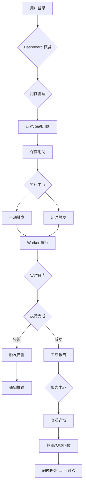

# Web 自动化管理系统 - 产品需求文档 (PRD)

## 1. Product Overview

一个面向 QA/开发团队的 Web 自动化测试管理平台，统一管理自动化脚本、执行引擎、测试报告与告警通知。解决自动化脚本分散、执行不可视、报告不统一、问题难追溯的痛点。

- **目标用户**: QA 工程师、开发工程师、测试经理
- **核心价值**: 提升自动化测试效率 50%+，缩短问题定位时间，实现持续交付中的质量门禁

## 2. Core Features

### 2.1 Feature Module

| 模块 | 说明 | 优先级 |
|------|------|--------|
| Dashboard (首页) | 数据概览、最近执行、系统状态 | P0 |
| 元素库 | 页面元素管理，支持录制生成/自动识别/手动添加 | P0 |
| 用例管理 | 脚本上传/编辑/分组/标签/版本 | P0 |
| 执行中心 | 任务触发、实时日志、并发控制 | P0 |
| 报告中心 | 截图/视频/日志、历史趋势 | P0 |
| 环境管理 | 测试环境配置、数据字典 | P1 |
| 定时调度 | Cron 表达式、触发规则 | P1 |
| 告警通知 | 钉钉/飞书/邮件通知 | P1 |

### 2.2 Page Details

| Page Name | Module Name | Feature Description |
|-----------|-------------|---------------------|
| Dashboard | 数据统计卡片 | 总用例数、通过率、今日执行数、失败数 |
| Dashboard | 最近执行列表 | 最近 10 条执行记录，状态标识 |
| Dashboard | 执行趋势图表 | 近 7 天执行趋势折线图 |
| Dashboard | 系统状态 | Worker 节点健康状态 |
| 元素库 | 元素列表 | 三栏布局：左侧来源筛选 + 中间元素列表 + 右侧详情面板 |
| 元素库 | 自动识别弹窗 | 4步向导：输入URL → 打开浏览器 → 悬浮按钮识别 → 去重结果导入 |
| 元素库 | 手动添加 | 填写选择器/类型/描述等信息创建元素 |
| 用例管理 | 用例列表 | 卡片式列表，支持搜索/筛选/分页 |
| 用例管理 | 用例详情 | 脚本预览、版本历史、执行记录 |
| 用例管理 | 新建/编辑 | 代码编辑器、环境选择、参数配置 |
| 执行中心 | 执行队列 | 等待中/执行中/已完成的任务队列 |
| 执行中心 | 实时日志 | WebSocket 推送的实时执行日志流 |
| 执行中心 | 并发控制 | 并发数配置、节点分配 |
| 报告中心 | 报告列表 | 按时间/用例/状态筛选历史报告 |
| 报告中心 | 报告详情 | 步骤详情、截图预览、失败原因分析 |
| 报告中心 | 附件查看 | 视频回放、日志下载、HAR 文件 |
| 环境管理 | 环境列表 | Dev/Staging/Prod 多环境管理 |
| 环境管理 | 配置管理 | URL、账号、API Token、数据变量 |
| 定时调度 | 规则列表 | Cron 表达式、关联用例、启停控制 |
| 告警通知 | 通道配置 | Webhook 地址、通知模板、告警级别 |

## 3. Core Process

**主要用户流程:**

1. **用例创建流程**: 用户进入用例管理 → 新建用例 → 填写脚本内容和配置 → 保存入库
2. **执行流程**: 用户选择用例 → 点击执行 → 系统分配 Worker → 实时显示日志 → 执行完成
3. **报告查看流程**: 执行完成后 → 自动跳转报告 → 查看步骤详情和截图 → 分析失败原因
4. **定时任务流程**: 配置 Cron 规则 → 系统按计划触发 → 执行并生成报告 → 异常时告警

## 4. User Interface Design

### 4.1 Design Style

- **整体风格**: 暗色科技风，深色背景配高对比度强调色，专业感与现代感兼顾
- **主色调**: `#0F172A` (深蓝黑背景) → `#1E293B` (卡片背景) → `#3B82F6` (主强调蓝)
- **辅助色**: 成功 `#10B981` / 警告 `#F59E0B` / 危险 `#EF4444`
- **字体**: 中文使用 `PingFang SC` / `Noto Sans SC`，英文使用 `JetBrains Mono` (代码) / `Inter` (UI)
- **按钮风格**: 圆角 8px，微妙阴影，hover 状态有颜色加深过渡
- **布局风格**: 左侧固定导航 + 顶部工具栏 + 主内容区三栏布局
- **图标风格**: Lucide Icons，线性风格，24x24px，描边 1.5px
- **动效**: 页面切换 300ms 淡入，卡片 hover 微抬升，进度条流畅动画

### 4.2 Page Design Overview

| Page Name | Module Name | UI Elements |
|-----------|-------------|-------------|
| Dashboard | 数据卡片 | 4 列网格卡片，每张卡片含图标+数值+环比趋势 |
| Dashboard | 执行趋势 | SVG 折线图，渐变填充，hover 显示数值 |
| Dashboard | 执行列表 | 紧凑表格，状态用彩色 badge 标识 |
| 用例管理 | 筛选栏 | 搜索框 + 下拉筛选 + 标签多选 + 新建按钮 |
| 用例管理 | 用例卡片 | 卡片布局，标题/标签/最近状态/操作按钮 |
| 用例管理 | 编辑器 | 左侧文件树 + 右侧 Monaco 代码编辑器 + 底部配置面板 |
| 执行中心 | 任务队列 | 左侧队列列表 + 右侧实时日志终端 |
| 执行中心 | 日志终端 | 黑色背景终端风格，彩色日志级别，自动滚动 |
| 报告中心 | 报告列表 | 表格列表，含缩略图/状态/耗时/操作 |
| 报告中心 | 报告详情 | 左侧步骤列表 + 右侧截图预览 + 底部日志 |
| 环境管理 | 环境卡片 | 每个环境一张卡片，含配置项编辑表单 |
| 定时调度 | 规则列表 | 表格 + Cron 可视化解析 + 启停开关 |
| 告警通知 | 通道配置 | Webhook URL 输入 + 测试按钮 + 模板编辑器 |

### 4.3 Responsiveness

- **桌面优先**: 主要针对 1440px+ 宽屏设计
- **平板适配**: 1024px 时隐藏次要侧栏，压缩卡片间距
- **移动端**: 仅保留 Dashboard 概览和报告查看核心功能

### 4.4 Key UI Components

- **Sidebar**: 固定 240px 宽，品牌 Logo + 导航菜单（图标+文字），底部版本信息
- **TopBar**: 高度 64px，面包屑导航 + 全局搜索 + 通知铃铛 + 用户头像
- **StatCard**: 统计卡片，含渐变背景条 + 图标 + 数字 + 趋势箭头
- **StatusBadge**: 状态徽章，圆形/圆角，成功(绿)/失败(红)/运行中(蓝)/等待(灰)
- **LogTerminal**: 日志终端组件，等宽字体，彩色级别标签，自动滚动到底部
- **ElementCard**: 元素卡片，选择器预览 + 类型标签 + 来源徽章 + 操作按钮
- **AutoImportDialog**: 自动识别向导，4步流程（url→opening→ready→results），含浏览器模式切换、去重统计
