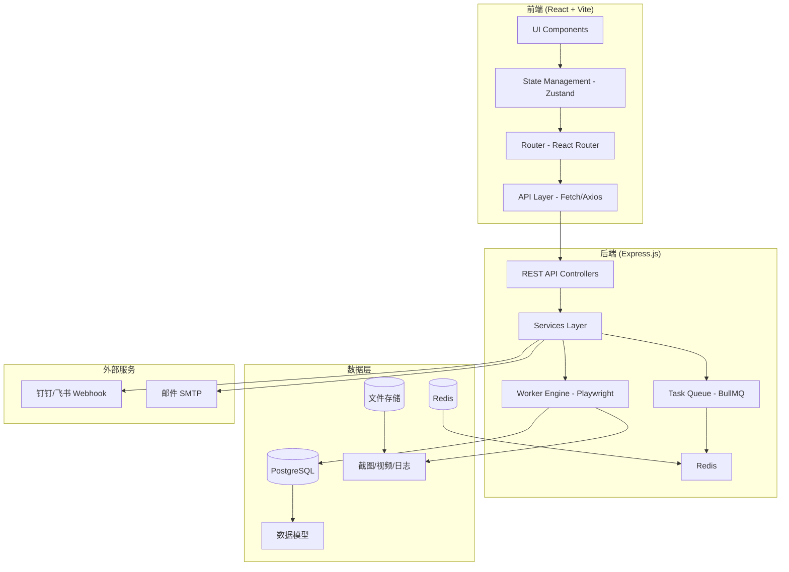
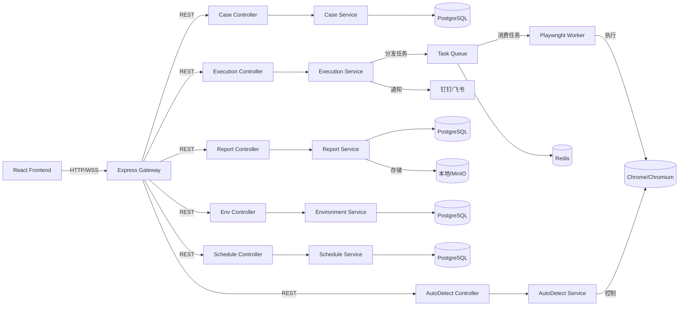
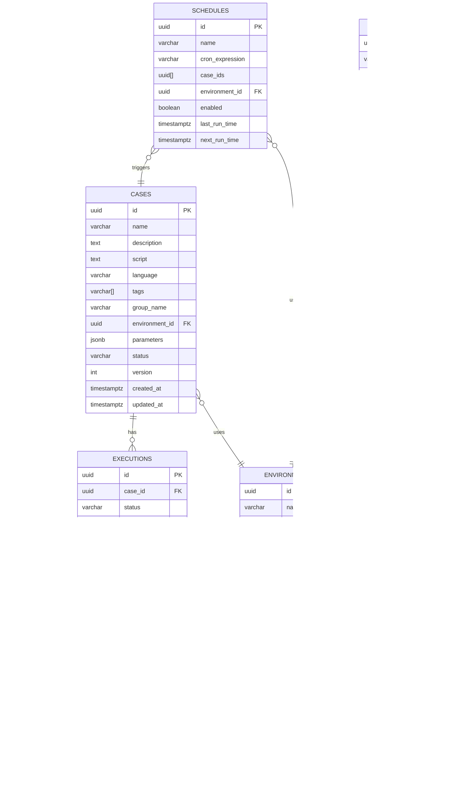

# Web 自动化管理系统 - 技术架构文档

## 1. Architecture Design



## 2. Technology Description

| 层级 | 技术选型 | 版本 | 说明 |
|------|----------|------|------|
| 前端框架 | React + TypeScript | 18.x | 主流前端框架，生态成熟 |
| 构建工具 | Vite | 6.x | 快速开发和构建 |
| 样式方案 | Tailwind CSS | 3.x | 原子化 CSS，开发效率高 |
| 状态管理 | Zustand | 5.x | 轻量级状态管理 |
| 路由 | React Router | 7.x | 声明式路由 |
| 图标 | Lucide React | 最新 | 线性风格图标库 |
| 图表 | Recharts / SVG | 最新 | 数据可视化 |
| 后端框架 | Express.js + TypeScript | 4.x | REST API 服务 |
| 自动化引擎 | Playwright | 1.52+ | Web 自动化执行核心 |
| 运行时 | tsx | 4.x | TypeScript 开发/运行 |

## 3. Route Definitions

| Route | Purpose | Page Component |
|-------|---------|----------------|
| `/` | Dashboard 首页 | Dashboard |
| `/cases` | 用例管理列表 | CaseList |
| `/cases/new` | 新建用例 | CaseEditor |
| `/cases/:id` | 用例详情/编辑 | CaseEditor |
| `/execution` | 执行中心 | ExecutionCenter |
| `/execution/:id` | 执行详情/实时日志 | ExecutionDetail |
| `/reports` | 报告中心列表 | ReportList |
| `/reports/:id` | 报告详情 | ReportDetail |
| `/environments` | 环境管理 | EnvironmentList |
| `/schedules` | 定时调度 | ScheduleList |
| `/alerts` | 告警通知配置 | AlertConfig |
| `/settings` | 系统设置 | Settings |

## 4. API Definitions

### 4.1 用例相关 API

```typescript
// Case - 自动化用例
interface Case {
  id: string;
  name: string;
  description: string;
  script: string;              // Playwright 脚本内容
  language: 'typescript' | 'python';
  tags: string[];
  group: string;
  environmentId: string;       // 关联环境
  parameters: Record<string, string>;
  status: 'active' | 'archived' | 'draft';
  version: number;
  createdAt: string;
  updatedAt: string;
}
```

| Method | Endpoint | Description |
|--------|----------|-------------|
| GET | `/api/cases` | 列表查询，支持分页/筛选/搜索 |
| POST | `/api/cases` | 创建新用例 |
| GET | `/api/cases/:id` | 获取用例详情 |
| PUT | `/api/cases/:id` | 更新用例 |
| DELETE | `/api/cases/:id` | 删除用例 |
| POST | `/api/cases/:id/execute` | 触发执行 |

### 4.2 执行相关 API

```typescript
// Execution - 执行记录
interface Execution {
  id: string;
  caseId: string;
  caseName: string;
  status: 'pending' | 'running' | 'success' | 'failed' | 'timeout';
  startTime: string;
  endTime: string;
  duration: number;            // 毫秒
  logs: LogEntry[];
  screenshots: Screenshot[];
  videoUrl?: string;
  errorMessage?: string;
  steps: StepResult[];
}

interface LogEntry {
  timestamp: string;
  level: 'info' | 'warn' | 'error' | 'debug';
  message: string;
}

interface StepResult {
  name: string;
  status: 'pass' | 'fail' | 'skip';
  duration: number;
  screenshotUrl?: string;
  error?: string;
}
```

| Method | Endpoint | Description |
|--------|----------|-------------|
| GET | `/api/executions` | 执行历史列表 |
| GET | `/api/executions/:id` | 执行详情 |
| WS | `/ws/executions/:id/logs` | 实时日志 WebSocket |
| POST | `/api/executions/:id/cancel` | 取消执行 |

### 4.3 环境相关 API

```typescript
// Environment - 测试环境
interface Environment {
  id: string;
  name: string;                // 'Dev', 'Staging', 'Prod'
  baseUrl: string;
  variables: Record<string, string>;  // 环境变量
  accounts: Account[];
  status: 'active' | 'inactive';
}

interface Account {
  username: string;
  password: string;
  description?: string;
}
```

### 4.4 定时调度 API

```typescript
// Schedule - 定时规则
interface Schedule {
  id: string;
  name: string;
  cronExpression: string;      // '0 9 * * 1-5'
  caseIds: string[];
  environmentId: string;
  enabled: boolean;
  lastRunTime?: string;
  nextRunTime?: string;
}
```

### 4.5 自动检测 API（已实现 ✅）

```typescript
// 自动检测会话
interface AutoDetectSession {
  sessionId: string;
  url: string;
  headless: boolean;
  status: "opening" | "ready" | "scanning" | "closed";
  elements: DetectedElement[];
  createdAt: string;
}

// 检测到的元素
interface DetectedElement {
  id: string;
  suggestedName: string;
  type: ElementType;
  selector: string;
  selectorType: "css" | "xpath" | "text" | "role";
  description?: string;
  tag?: string;
  checked: boolean;
}
```

| Method | Endpoint | Description |
|--------|----------|-------------|
| POST | `/api/auto-detect/open` | 启动浏览器访问 URL，注入悬浮按钮，返回 sessionId |
| POST | `/api/auto-detect/scan/:sessionId` | 服务端触发 DOM 扫描，返回去重后元素列表 |
| POST | `/api/auto-detect/report/:sessionId` | 接收浏览器端悬浮按钮回传的扫描结果 |
| GET | `/api/auto-detect/status/:sessionId` | 获取会话状态 |
| GET | `/api/auto-detect/elements/:sessionId` | 获取已识别的元素列表（前端轮询用） |
| POST | `/api/auto-detect/close/:sessionId` | 关闭浏览器页面和会话 |

**去重策略**：按 CSS/XPath 选择器去重，相同 selector 只保留第一个，空选择器自动丢弃。

**悬浮按钮机制**：
- 浏览器启动后自动注入 JS 脚本
- 页面右下角显示渐变紫色「🔍 识别元素」按钮
- 点击按钮 → 遍历 DOM（button/input/link/img/select/checkbox/radio/container）→ POST 回传结果
- 前端同时支持"服务端强制扫描"和"拉取识别结果"两种触发方式

## 5. Server Architecture Diagram



## 6. Data Model

### 6.1 ER Diagram



### 6.2 Data Definition Language

```sql
-- 用例表
CREATE TABLE cases (
    id UUID PRIMARY KEY DEFAULT gen_random_uuid(),
    name VARCHAR(200) NOT NULL,
    description TEXT,
    script TEXT NOT NULL,
    language VARCHAR(20) DEFAULT 'typescript',
    tags TEXT[] DEFAULT '{}',
    group_name VARCHAR(100),
    environment_id UUID REFERENCES environments(id),
    parameters JSONB DEFAULT '{}',
    status VARCHAR(20) DEFAULT 'active',
    version INT DEFAULT 1,
    created_at TIMESTAMPTZ DEFAULT NOW(),
    updated_at TIMESTAMPTZ DEFAULT NOW()
);

CREATE INDEX idx_cases_status ON cases(status);
CREATE INDEX idx_cases_group ON cases(group_name);
CREATE INDEX idx_cases_tags ON cases USING GIN(tags);

-- 执行记录表
CREATE TABLE executions (
    id UUID PRIMARY KEY DEFAULT gen_random_uuid(),
    case_id UUID NOT NULL REFERENCES cases(id),
    status VARCHAR(20) DEFAULT 'pending',
    start_time TIMESTAMPTZ,
    end_time TIMESTAMPTZ,
    duration INT,
    error_message TEXT,
    steps JSONB DEFAULT '[]',
    created_at TIMESTAMPTZ DEFAULT NOW()
);

CREATE INDEX idx_executions_case ON executions(case_id);
CREATE INDEX idx_executions_status ON executions(status);
CREATE INDEX idx_executions_time ON executions(created_at DESC);

-- 环境表
CREATE TABLE environments (
    id UUID PRIMARY KEY DEFAULT gen_random_uuid(),
    name VARCHAR(100) NOT NULL,
    base_url VARCHAR(500),
    variables JSONB DEFAULT '{}',
    accounts JSONB DEFAULT '[]',
    status VARCHAR(20) DEFAULT 'active',
    created_at TIMESTAMPTZ DEFAULT NOW()
);

-- 定时调度表
CREATE TABLE schedules (
    id UUID PRIMARY KEY DEFAULT gen_random_uuid(),
    name VARCHAR(200) NOT NULL,
    cron_expression VARCHAR(50) NOT NULL,
    case_ids UUID[] DEFAULT '{}',
    environment_id UUID REFERENCES environments(id),
    enabled BOOLEAN DEFAULT TRUE,
    last_run_time TIMESTAMPTZ,
    next_run_time TIMESTAMPTZ,
    created_at TIMESTAMPTZ DEFAULT NOW()
);

-- 告警通道表
CREATE TABLE alert_channels (
    id UUID PRIMARY KEY DEFAULT gen_random_uuid(),
    name VARCHAR(100) NOT NULL,
    type VARCHAR(50) NOT NULL,
    webhook_url VARCHAR(500),
    config JSONB DEFAULT '{}',
    enabled BOOLEAN DEFAULT TRUE,
    created_at TIMESTAMPTZ DEFAULT NOW()
);
```

## 7. Project Structure

```
d:\自动化管理\
├── .trae/
│   └── documents/
│       ├── prd.md
│       ├── tech-architecture.md
│       └── development-plan.md
├── src/                          # 前端源代码 (React + TypeScript)
│   ├── components/              # 可复用组件
│   │   ├── Sidebar.tsx            侧边栏导航
│   │   ├── TopBar.tsx             顶部工具栏
│   │   ├── StatCard.tsx           统计卡片
│   │   ├── StatusBadge.tsx        状态徽章
│   │   └── LogTerminal.tsx        日志终端组件
│   ├── pages/                    # 页面组件
│   │   ├── Dashboard.tsx          首页仪表盘
│   │   ├── Cases.tsx              用例管理列表
│   │   ├── CaseEditor.tsx         用例编辑器
│   │   ├── Recorder.tsx           录制功能
│   │   ├── ElementLibrary.tsx     元素库（含自动识别导入）
│   │   ├── Execution.tsx          执行中心
│   │   ├── Reports.tsx            报告中心
│   │   ├── ReportDetail.tsx       报告详情
│   │   ├── Environments.tsx       环境管理
│   │   ├── Schedules.tsx          定时调度
│   │   ├── Alerts.tsx             告警通知
│   │   └── Settings.tsx           系统设置
│   ├── store/                     # Zustand 状态管理
│   │   └── elementStore.ts        元素库全局状态
│   ├── data/                      # Mock 数据
│   │   ├── mock.ts
│   │   └── elements.ts
│   ├── types/                     # TypeScript 类型定义
│   │   └── index.ts
│   ├── lib/                       # 工具函数
│   │   └── utils.ts
│   ├── App.tsx
│   ├── main.tsx
│   └── index.css
├── api/                          # 后端源代码 (Express + Playwright) ✅ 已实现
│   ├── src/
│   │   ├── index.ts                Express 服务器入口 + REST 路由
│   │   ├── browser.ts              Playwright 浏览器管理器（有头/无头双实例）
│   │   ├── inject.ts               悬浮按钮注入脚本（DOM 扫描 + 回传）
│   │   ├── dedup.ts                选择器去重逻辑
│   │   └── types.ts                共享类型定义
│   ├── package.json
│   └── tsconfig.json
├── public/                       # 静态资源
├── package.json
├── tsconfig.json
├── vite.config.ts
├── tailwind.config.js
└── docker-compose.yml (待创建)
```

## 8. Database Setup Notes

- **PostgreSQL**: 主数据库，存储用例、执行记录、环境配置等结构化数据
- **Redis**: 
  - BullMQ 任务队列（执行任务的分发和消费）
  - 实时日志的 Pub/Sub（WebSocket 日志推送）
  - 执行状态缓存
- **文件存储**: 截图、视频、HAR 文件等非结构化数据存储在本地磁盘或 MinIO，数据库仅存路径引用
